# Image review (owner)

Open this in a Markdown preview (VS Code: Cmd+Shift+V) to see the images. Each entry says what the image is meant to show, what must be true for it to teach that correctly, and what I'm unsure about. Tick a verdict and add a note; I'll reroll, fix or drop from there. Delete this file once every image has a verdict.

**None of these images is meant to show a mistake.** Every one shows correct, lawful practice, except no. 3, which shows a *hazard* (nobody breaks a rule; the point is the danger). So anything that looks wrong is a defect in the image, not a teaching device.

Every image is labelled "ilustrativa" on the site. Prompts forbid signs and text, so missing signs and blank plates are intended.

## 1. luces-niebla-faros
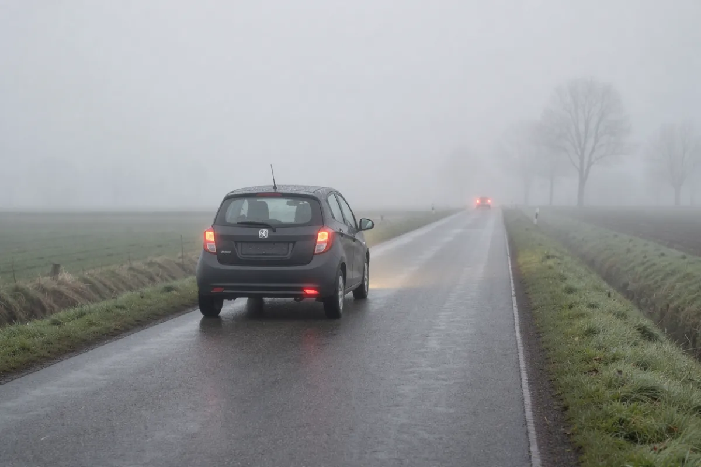
- Lesson: `luces/02-niebla-y-estacionado`, after the rear-fog-light rule.
- Meant to show: correct use of the rear fog light (mistachterlicht) in thick fog.
- Must be true: visibility clearly under 50 m (the legal condition, RVV 34.2); one rear fog light lit on the car ahead; dipped lights on.
- Unsure: trees and an oncoming car are visible fairly far off, so visibility may read as more than 50 m, which would show the light used when it isn't allowed. The car's plate is a dark blank, not Dutch yellow.
- Verdict: [ ] OK  [ ] Reroll  [ ] Drop. Note:

## 2. luces-averia-triangulo
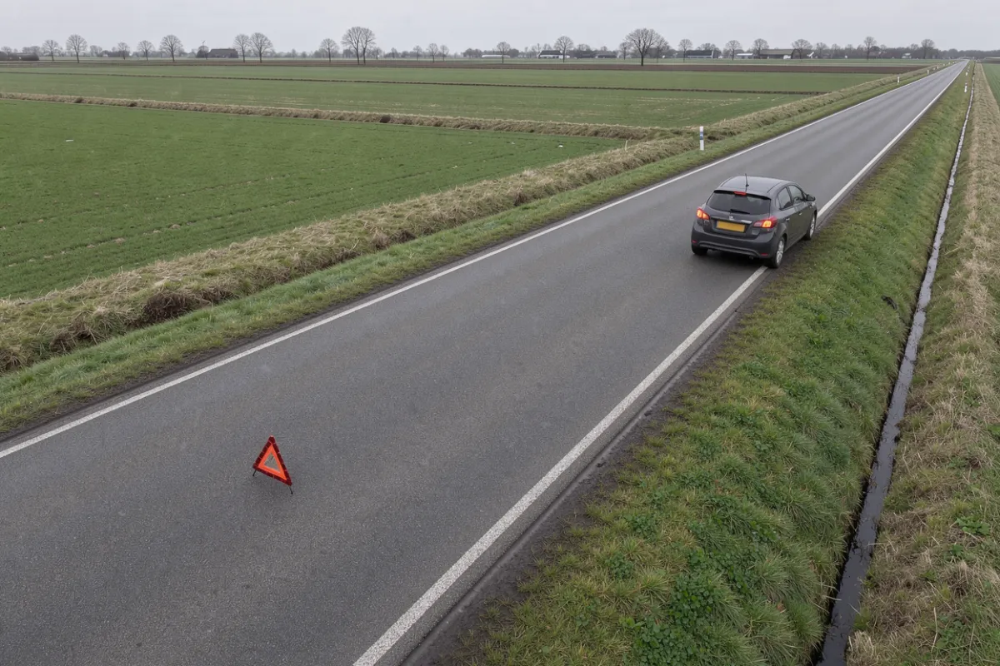
- Lesson: `luces/04-averia-emergencia`, after "a unos 30 metros".
- Meant to show: correct placement of the warning triangle behind a broken-down car.
- Must be true: triangle behind the car (we see the car's rear), facing approaching traffic, in the same lane, about 30 m back; hazard lights on.
- Unsure: perspective makes the distance hard to judge (I read it as 20-30 m). The car stands on the road at the edge, not on the verge.
- Verdict: [ ] OK  [ ] Reroll  [ ] Drop. Note:

## 3. conductor-dode-hoek-camion
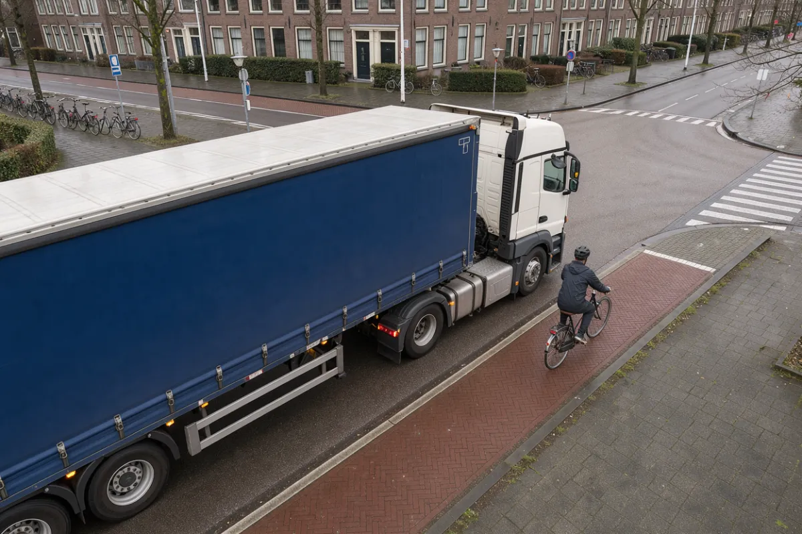
- Lesson: `conductor/05-usuarios-vulnerables`, "Ángulo muerto".
- Meant to show: a **hazard**: a cyclist beside the cab of a lorry at a junction, in the zone the lorry driver can't see.
- Must be true: the cyclist is on their own path, right next to the cab's right side; the lorry could turn right across them.
- Unsure: the cyclist is near the front corner rather than level with the door, and the lorry isn't visibly signalling or turning.
- Verdict: [ ] OK  [ ] Reroll  [ ] Drop. Note:

## 4. conductor-asiento-infantil
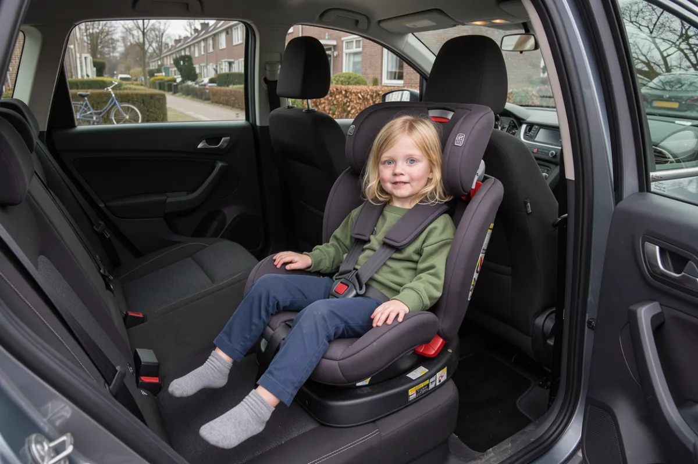
- Lesson: `conductor/04-cinturon-ninos`, after the RVV 59.1 rule.
- Meant to show: a young child correctly secured in a forward-facing child seat on the rear seat.
- Must be true: harness over both shoulders and buckled, chest clip at chest height, seat on a rear seat.
- Unsure: nothing specific; check that the harness routing looks right to you.
- Verdict: [ ] OK  [ ] Reroll  [ ] Drop. Note:

## 5. leyes-documentos-control
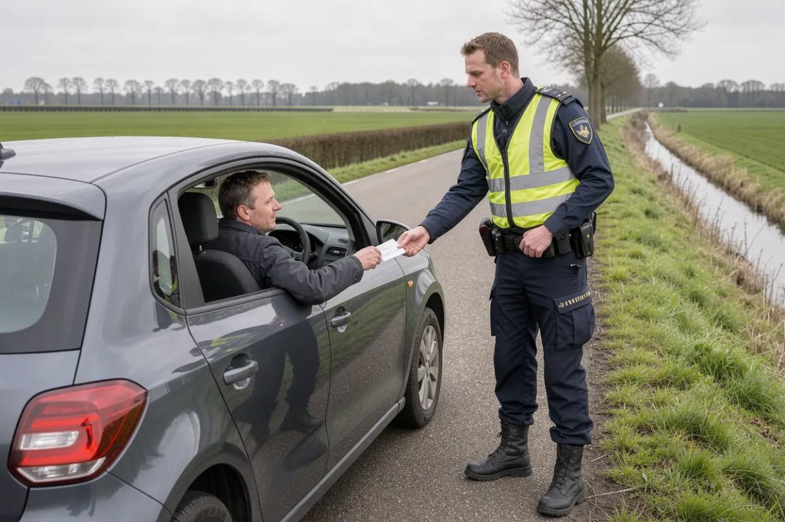
- Lesson: `leyes/03-documentos-control`, after "Mostrar documentos a la primera orden".
- Meant to show: a normal roadside check: the driver stopped and hands a document to a police officer.
- Must be true: car stopped at the roadside, officer at the driver's window, driver cooperating.
- Unsure: the vest is a generic yellow, not the Dutch police livery (blue-yellow with POLITIE), so it reads as "a police officer", not specifically Dutch.
- Verdict: [ ] OK  [ ] Reroll  [ ] Drop. Note:

## 6. vehiculo-banden-profiel
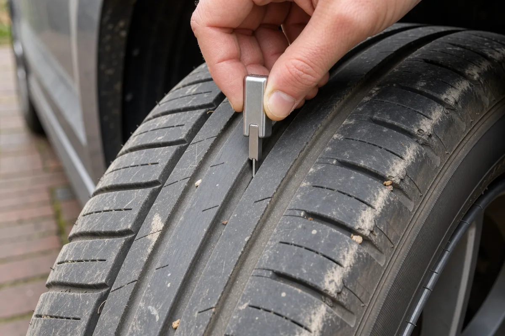
- Lesson: `vehiculo/01-neumaticos`, after the 1.6 mm warning.
- Meant to show: how to measure tread depth with a gauge.
- Must be true: tyre mounted on a car; the gauge's pin in a main groove, held upright.
- Unsure: the gauge is simplified (no visible scale). It does not show a worn tyre, and the caption doesn't claim one.
- Verdict: [ ] OK  [ ] Reroll  [ ] Drop. Note:

## 7. vehiculo-lading-fietsdrager
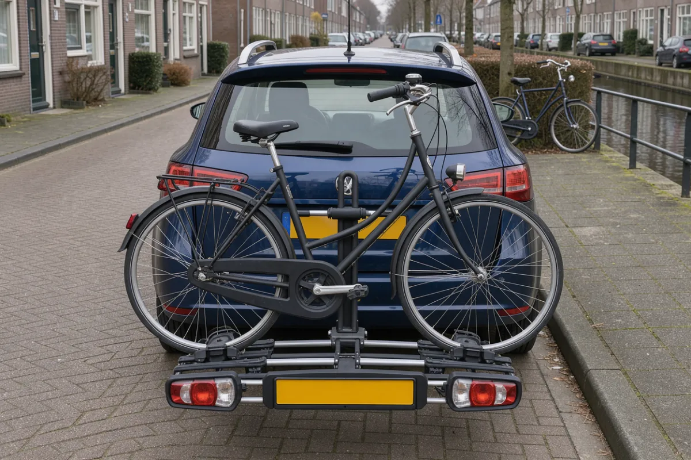
- Lesson: `vehiculo/06-carga-remolque`, after the rv 5.18.7 carrier rule.
- Meant to show: a correctly loaded tow-bar bike carrier that covers the car's lights and so has its own.
- Must be true: one bike, whole, fixed in the wheel trays and clamped by the frame; the carrier has its own rear lights and a (blank) plate holder; nothing sticks out more than 20 cm at the sides.
- Unsure: the frame clamp's join to the bike is a bit soft; the mount onto the tow ball is hidden.
- Verdict: [ ] OK  [ ] Reroll  [ ] Drop. Note:

## 8. vehiculo-aanhangwagen
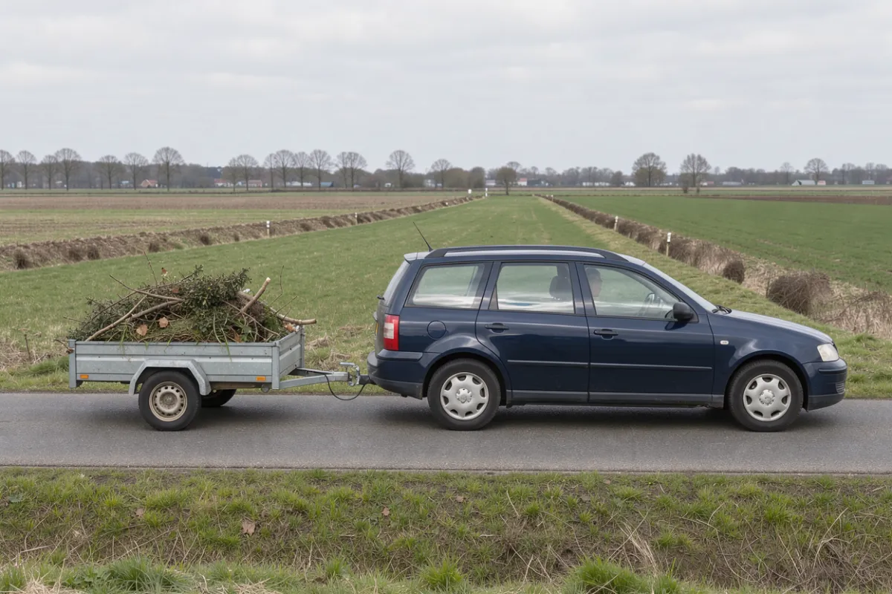
- Lesson: `vehiculo/06-carga-remolque`, after "Luces del remolque".
- Meant to show: a correctly coupled light trailer being towed.
- Must be true: one trailer; coupling on the tow ball; light cable plugged in; only the trailer's own wheels on the road (no jockey wheel down); load not sticking out.
- Unsure: twigs stick up above the sides (not tied down or covered). rv 5.18.6/2 requires loose load that can blow off to be covered, so this may show a load that isn't secured.
- Verdict: [ ] OK  [ ] Reroll  [ ] Drop. Note:

## 9. especiales-tunnel
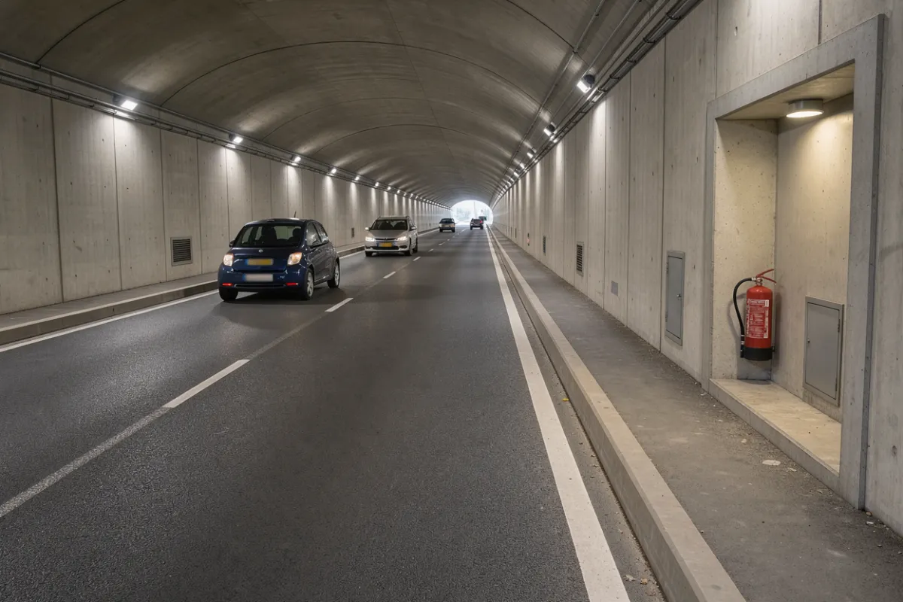
- Lesson: `especiales/05-tunel`, after the fire rules.
- Meant to show: an emergency alcove with a fire extinguisher in a road tunnel.
- Must be true: lit recess in the wall with an extinguisher; normal traffic.
- Unsure: it's a two-way tunnel with a **dashed** centre line, while the lesson says never to cross the centre line. The alcove has no emergency phone.
- Verdict: [ ] OK  [ ] Reroll  [ ] Drop. Note:

## 10. especiales-overweg
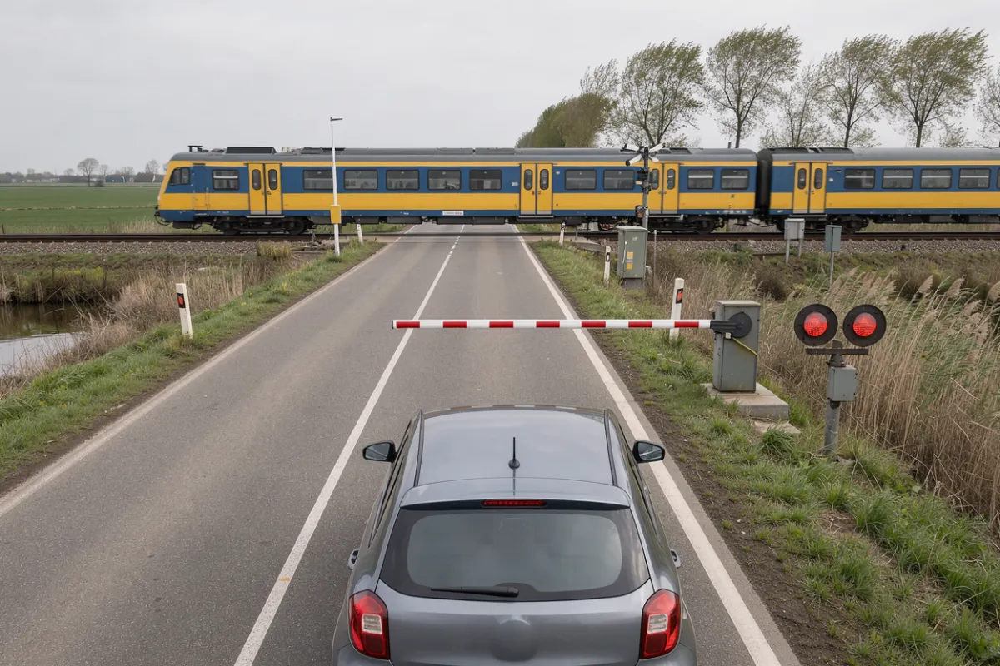
- Lesson: `especiales/07-overweg`, AHOB section.
- Meant to show: correct waiting at an AHOB crossing: half barrier down over our lane, red lights on, train passing, car stopped in its lane well before the barrier.
- Must be true: half barrier covers only the right lane; two red lights lit; car not on the crossing and not beside the barrier.
- Unsure: the lights can't show that they flash (a still image).
- Verdict: [ ] OK  [ ] Reroll  [ ] Drop. Note:

## 11. especiales-erf
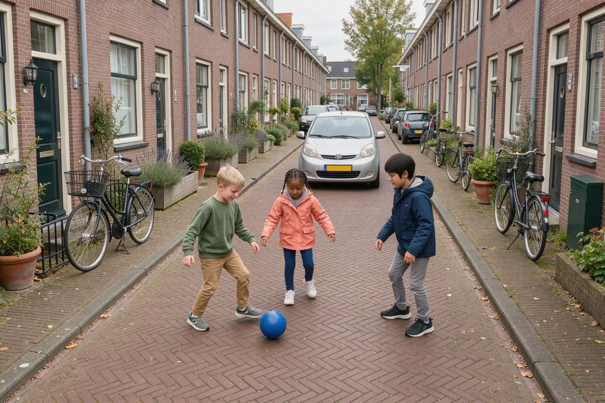
- Lesson: `especiales/08-erf-halte-brug`, after the erf rules.
- Meant to show: an erf (woonerf): pedestrians, including children, using the whole street, and a car moving at walking pace.
- Must be true: children on the carriageway is normal here; the car is slow and giving them room.
- Unsure: the street has raised curbs and sidewalks, which undercuts the shared-space point. The car looks close to the children and could read as about to drive into them.
- Verdict: [ ] OK  [ ] Reroll  [ ] Drop. Note:

## Dropped (for reference)
- `via-tipos-ciclomotores`: a speed pedelec is told apart by its plate, which the no-text rule forbids.
- `especiales-invoegstrook`: the model never drew the block marking of a Dutch acceleration lane; to become an SVG diagram.
